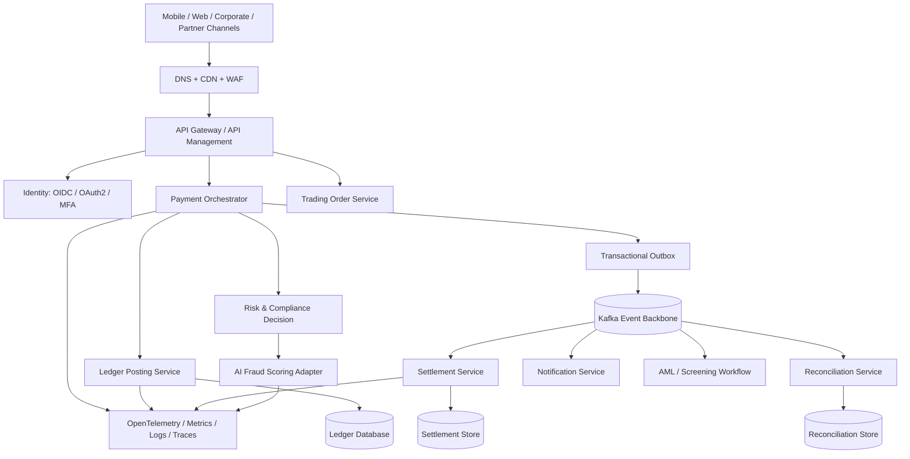

# FinCore — Enterprise Banking & Financial Services Architecture Portfolio

**Positioning:** Senior Solution Architect | Java 21 | Spring Boot | Microservices | Kafka | Cloud | AI/ML

> A reference architecture for secure, resilient and auditable financial services. It demonstrates business-led architecture, distributed systems, financial controls, cloud-native engineering and responsible AI integration.

**Important:** This is a portfolio/reference design, not a certified banking product, regulatory opinion, production deployment or claim of measured production results. Validate jurisdiction-specific obligations, cloud capabilities, threat controls and financial accounting rules with qualified stakeholders.

## Executive summary
FinCore illustrates a financial platform supporting payment initiation, account/ledger posting, settlement, reconciliation, compliance screening, fraud risk assessment and operational monitoring. It separates synchronous customer-facing validation from durable asynchronous processing, preserves auditability, and treats ledger correctness as a core invariant.

## Architecture at a glance

## Business capabilities
| Capability | Business outcome | Key control |
|---|---|---|
| Payment initiation | Accept payment instructions | Authentication, validation, idempotency |
| Risk & compliance | Assess transaction risk and policy | Rules, screening, audit, escalation |
| Ledger | Record financial movements | Balanced postings, immutability, authorization |
| Settlement | Complete obligations with counterparties | Cut-off calendars, status tracking |
| Reconciliation | Identify breaks across internal/external records | Matching, exception workflow, evidence |
| Trading | Manage order lifecycle | Pre-trade limits, validation, audit |
| AI risk signals | Prioritize suspicious activity | Explainability, thresholds, human review |

## Non-functional objectives (proposed, validate with business)
- Availability: define per capability and customer journey; an illustrative 99.95% target is not a guarantee.
- Latency: separate real-time authorization/acceptance targets from asynchronous settlement completion.
- Integrity: no silent loss or duplicate financial posting; immutable audit evidence.
- Security: least privilege, strong customer authentication where applicable, encryption, secrets management and monitored privileged access.
- Resilience: bounded retries, idempotent processing, durable events, tested recovery and controlled degradation.
- Recovery: agree RTO/RPO by service and data classification; test restore and failover.
- Compliance: map obligations only after identifying countries, products, data types and regulated entities.

## Repository guide
- `docs/business-context.md` — business scenarios, actors, requirements and assumptions
- `architecture/` — HLD, payment sequence, ledger, trading, cloud, security, resilience, AI and observability
- `services/` — Java/Spring implementation patterns and illustrative code
- `events/` — event contracts and schema evolution
- `adr/` — documented architecture decisions and trade-offs
- `delivery/` — CI/CD, testing, release and governance
- `operations/` — SLOs, incident scenarios, DR and runbooks
- `interview/` — executive presentation and interview questions

## Design principles
1. Financial correctness and auditability over convenience.
2. Explicit business invariants and ownership boundaries.
3. Idempotency at every retriable boundary.
4. No distributed database transaction across services.
5. Durable event publication using the outbox pattern.
6. Least privilege and zero-trust service identity.
7. Human accountability for material AI-assisted decisions.
8. Measure reliability and unit economics continuously.

## Suggested implementation roadmap
1. Build payment initiation and ledger posting as a vertical slice.
2. Add outbox publisher and Kafka consumer with deduplication.
3. Add settlement and reconciliation workflows.
4. Add risk rules and AI scoring in shadow mode.
5. Add observability, security automation and deployment manifests.
6. Run failure injection, load tests and recovery exercises.

## Interview talking points
- Why a ledger is not just a CRUD table.
- How idempotency prevents duplicate financial effects.
- Why payment acceptance is not the same as settlement completion.
- How outbox, event versioning and consumer deduplication work together.
- How AI risk scores are governed, monitored and overridden.
- How you balance availability, consistency, security and cost.

---
**Portfolio honesty:** All targets and scenarios are illustrative until validated. Do not claim production implementation, certification, transaction volume, availability or cost savings unless you can substantiate them.
