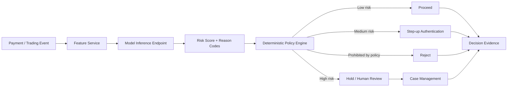

# Responsible AI — Fraud and Anomaly Detection

## AI-assisted decision flow


## Responsible design
- Keep model inference separate from the authoritative ledger and posting boundary.
- Use deterministic policy thresholds and approved business rules to map scores to actions.
- Support human review, appeal/override and evidence capture for material decisions.
- Log model version, feature version, score, reason codes, policy version and decision actor.
- Monitor false positives, false negatives, drift, latency, data quality and segment-level performance.
- Use privacy-minimized features, access controls and retention policies.
- Run in shadow mode before allowing scores to influence live decisions.
- Have a fallback policy for model timeout/unavailability; risk appetite determines fail-open vs fail-closed behavior.

## Model lifecycle
Data governance → feature validation → training/validation → bias and performance assessment → approval → shadow deployment → controlled rollout → drift monitoring → rollback/retraining.

## Example API contract
`POST /internal/risk/v1/score`
```json
{
  "eventId": "evt-123",
  "subjectToken": "tok-customer-456",
  "amount": "250.00",
  "currency": "USD",
  "channel": "MOBILE",
  "eventTimestamp": "2026-11-22T10:00:00Z"
}
```
Example response:
```json
{
  "score": 0.82,
  "riskBand": "HIGH",
  "reasonCodes": ["VELOCITY_ANOMALY", "DEVICE_CHANGE"],
  "modelVersion": "fraud-model-12",
  "decision": "REVIEW"
}
```
The values are illustrative. A score is not a probability unless calibrated and validated as such. Do not expose sensitive features to clients.
