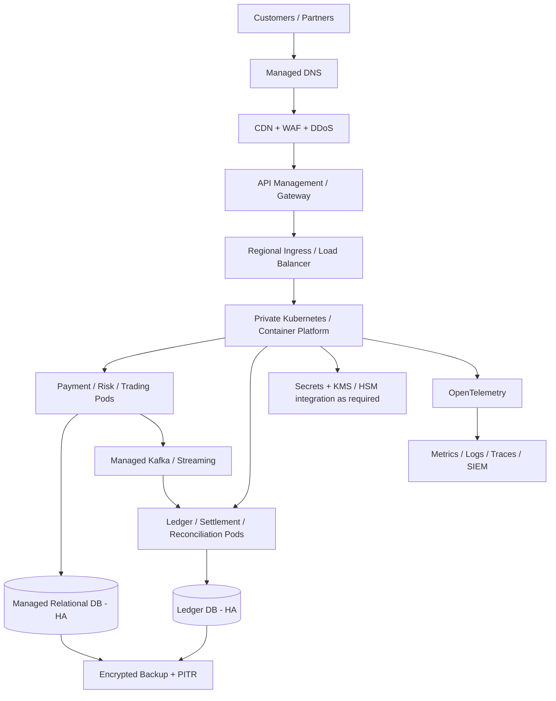

# Cloud Reference Architecture and Provider Mapping

## Deployment view

## Capability mapping (verify current regional service details)
| Capability | AWS | Azure | OCI |
|---|---|---|---|
| DNS | Route 53 | Azure DNS | OCI DNS |
| Edge/WAF | CloudFront, AWS WAF, Shield | Front Door, WAF, DDoS Protection | OCI WAF / edge options |
| API management | API Gateway | API Management | API Gateway |
| Load balancing | ALB/NLB | Application Gateway / Load Balancer | OCI Load Balancer |
| Kubernetes | EKS | AKS | OKE |
| Relational DB | RDS/Aurora | Azure Database for PostgreSQL / SQL | Oracle Database services / supported PostgreSQL options |
| Streaming | MSK / Kinesis | Event Hubs | OCI Streaming |
| Secrets/keys | Secrets Manager / KMS / CloudHSM | Key Vault / Managed HSM | Vault / Key Management |
| Monitoring | CloudWatch / partners | Azure Monitor | OCI Monitoring / Logging |

## Architecture considerations
- Use multiple availability zones for regional fault tolerance; assess region-level DR separately.
- Use managed databases with tested failover and backup recovery.
- Autoscale stateless services using CPU/memory and workload signals, with safe min/max bounds.
- Protect database connection limits with pooling and backpressure.
- Consider HSM-backed key operations where required by threat model, payment scheme or regulation.
- Isolate workloads and data paths with private networking and least-privilege identities.
- Multi-region active-active increases complexity and cost; choose based on RTO/RPO, data consistency, residency and operational readiness.

## Availability math
An illustrative 99.9% monthly availability objective corresponds to about 43.8 minutes of downtime in a 30.4-day month. A 99.95% objective corresponds to about 21.9 minutes. Define the measurement window, exclusions, dependencies and customer journey precisely; infrastructure uptime alone is not end-to-end availability.

## Cost optimization
Measure cost per successful payment / per 1,000 orders, not just monthly cloud spend. Right-size compute and database, tune queries, manage Kafka partitions/retention, control log cardinality/retention, reduce cross-zone data transfer, use commitments for stable baseline only, and preserve required redundancy and security controls.
