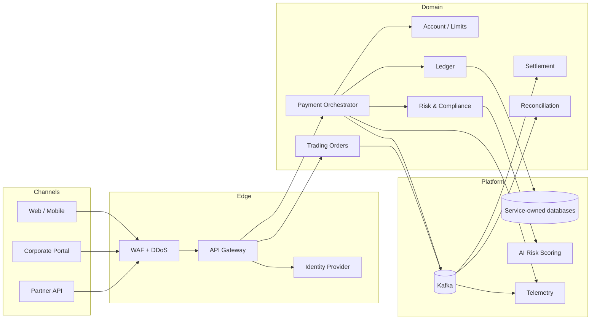

# High-Level Design

## Logical architecture

## Component responsibilities
| Component | Responsibility | Important invariant |
|---|---|---|
| API Gateway | Routing, quotas, token validation integration | No business authorization bypass |
| Payment Orchestrator | Coordinate payment state machine | State transitions are valid and auditable |
| Account/Limits | Account status, available limits | Concurrency-safe limit enforcement |
| Risk/Compliance | Policy checks and case creation | Decisions carry policy/version and evidence |
| Ledger | Financial journal and posting | Debits equal credits per journal/currency |
| Trading Orders | Order validation and lifecycle | Every transition is authorized and traceable |
| Settlement | External clearing/settlement lifecycle | External confirmation is evidenced |
| Reconciliation | Compare internal/external records | Exceptions are never silently discarded |
| AI Risk Adapter | Model inference and explanation metadata | Model output is advisory to policy |

## Architecture style
Use domain-driven boundaries and independently deployable services where ownership, release cadence and scaling justify them. A modular monolith can be a better initial choice for a small team or tightly coupled domain. Microservices introduce network failure, eventual consistency, data duplication and operational overhead.

## Synchronous vs asynchronous
Synchronous APIs are appropriate for authentication, input validation, immediate eligibility checks and acceptance responses. Durable events are appropriate for downstream notifications, settlement progression, reconciliation and analytics. Do not synchronously chain every downstream dependency on the customer request path.

## Data architecture
Each service owns its data. Ledger writes are append-oriented journal entries; corrections are represented by compensating/reversal entries under controlled authorization, not destructive edits. Read models can be derived for statements and operational views. Define retention, encryption, access, backup and legal hold requirements with compliance and data owners.
