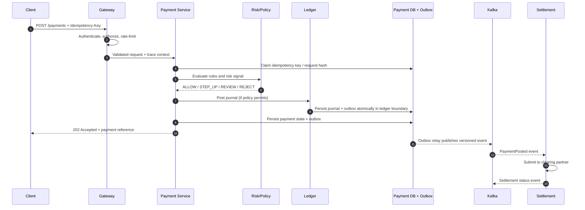
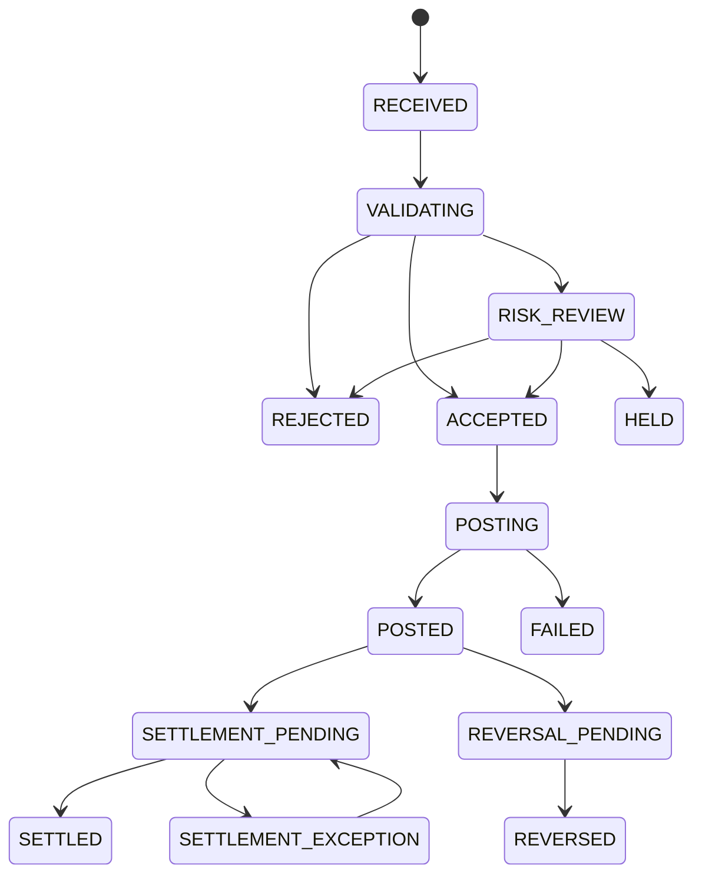

# Payment Lifecycle — Sequence and Failure Semantics

## Important implementation note
The diagram is conceptual. If payment state and ledger journal live in separate service databases, they cannot be committed atomically with a local database transaction. Use an explicit saga/process manager, durable commands/events, idempotent handlers and compensating business actions. Never imply a distributed ACID transaction exists across services.

## State machine

Only authorized transitions are permitted. Persist transition time, actor/system identity, reason, correlation ID, policy version and source evidence.
