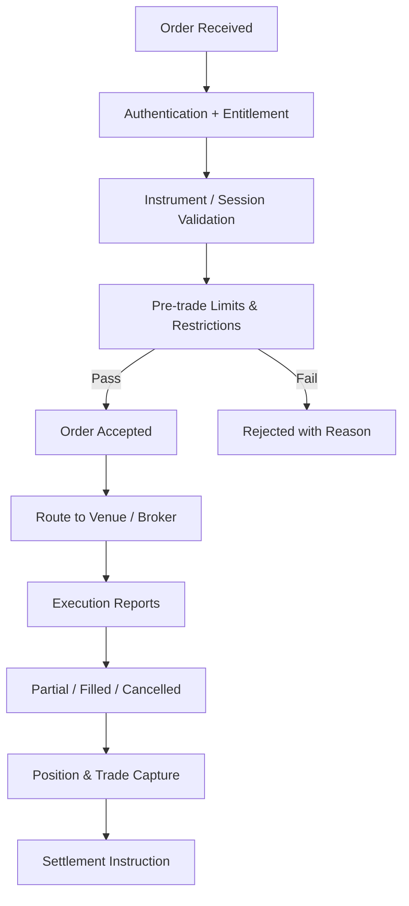
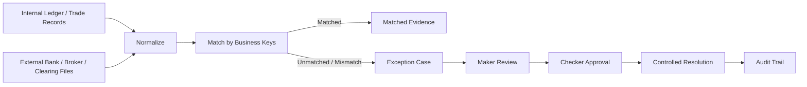

# Trading, Settlement and Reconciliation

## Trading order lifecycle

Order acceptance, execution, clearing and settlement are different states and must be represented separately. Enforce client entitlements, limit checks, duplicate client order IDs and auditable changes.

## Reconciliation process

Matching keys may include external reference, internal reference, amount, currency, value date and counterparty. Tolerance rules must be approved, versioned and explainable. Never auto-write a financial correction simply because a record failed matching.
