# CI/CD, Quality Gates and Release Strategy

```mermaid
flowchart LR
  PR[Pull Request] --> BUILD[Build + Unit Tests]
  BUILD --> SAST[SAST + Secret Scan]
  SAST --> DEP[Dependency / SBOM / Image Scan]
  DEP --> CONTRACT[Contract + Integration Tests]
  CONTRACT --> IMAGE[Immutable Container]
  IMAGE --> STAGE[Deploy to Non-Prod]
  STAGE --> PERF[Smoke / Load / Security Tests]
  PERF --> APPROVE[Risk-based Approval]
  APPROVE --> CANARY[Canary / Progressive Release]
  CANARY --> VERIFY[SLO + Business Verification]
  VERIFY -->|Failure| ROLLBACK[Rollback / Forward Fix]
```

## Quality gates
- Unit, integration, contract and end-to-end tests.
- Static analysis, dependency scanning, secret scanning and container scanning.
- API/event schema compatibility checks.
- IaC policy and security checks.
- Database migration compatibility and rollback/forward strategy.
- Performance baseline and critical journey tests.
- Release approval for high-risk financial control changes.
- Post-deployment technical and business verification.

## Release strategy
Use backward-compatible expand/contract migrations, canary or blue-green rollout, feature flags for reversible behavior, and explicit rollback criteria. Database and event changes need independent compatibility planning. Emergency changes require retrospective review and evidence.
